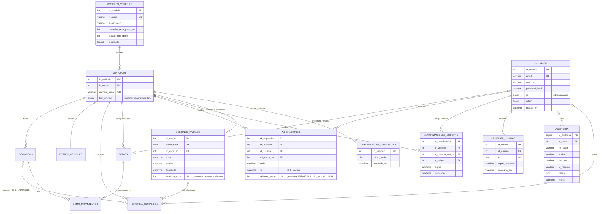

# 4.3 ADMINISTRACIÓN IoT — Etapa 1: Diagnóstico, esquema propuesto y dudas

Fecha: 2026-11-18. Alcance: lectura de `vehiculo_iot_api` (commit `51fae35`), `vehiculo_iot_front/control-iot` (commit `3df67e9`) y `wifi_excavadora` (firmware). **No se modificó la base de datos ni se cambió ningún código existente.**

Convención: **VERIFICADO** = visto en código, en respuesta real o en el DDL de RDS; **NO VERIFICADO** = supuesto.

**Actualización 2026-11-18 (noche):** con la instancia RDS encendida se extrajo el esquema real en modo solo lectura con `scripts/inventario_esquema.py` (DDL, 21 SP, conteos, permisos). La sección 1.5 y los riesgos R12–R16 ya están verificados.

---

## 1. Qué existe

### 1.1 Backend FastAPI (VERIFICADO en código)

- Capas: `routes/` → `db/operation_executor.py` (transacción) → `db/procedure_executor.py` (lista blanca de **21 procedimientos almacenados**). Por eso la UI dice "21 servicios": son los 21 SP; OpenAPI expone **27 operaciones** (25 en `/api` + `/` + `/health/db`).
- Sin capa de servicios/repositorios salvo `services/demo_executor.py`. Sin esquemas de respuesta Pydantic (`response_model`).
- Estado en memoria: conexiones WSS, ACK pendientes, tareas de demo, candado de comando individual. **Requiere un solo proceso uvicorn** (con `--workers >1` se rompe la correlación de ACK y la exclusión demo/comando).
- CORS: `localhost:3000`, `127.0.0.1:3000`, `https://80chucho08.github.io`; métodos `GET, POST, PUT` (falta `DELETE`); cabeceras `Accept, Content-Type` (falta `Authorization`).
- **Sin autenticación ni autorización** en ningún endpoint REST ni en el WSS.

### 1.2 Inventario de APIs → función en 4.3 → ajuste requerido

| # | Método y ruta actual | SP | Uso en 4.3 | Ajuste requerido |
|---|---|---|---|---|
| 1 | `GET /` | — | Indicador "API AWS" | Ninguno (público) |
| 2 | `GET /health/db` | — | Indicador RDS | Público pero sin exponer versión exacta a anónimos (opcional) |
| 3 | `GET /api/vehiculos` | sp_obtener_vehiculos | Inventario Admin | Solo Admin. Nuevo `GET /api/mis-vehiculos` para Usuario |
| 4 | `GET /api/vehiculos/{id}` | sp_obtener_vehiculo | Detalle de unidad | Admin, o Usuario propietario |
| 5 | `POST /api/vehiculos` | sp_crear_vehiculo | Alta de unidad | Solo Admin; agregar `id_modelo`, `numero_serie`, `tipo_unidad`; auditoría |
| 6 | `PUT /api/vehiculos/{id}` | sp_actualizar_vehiculo | Edición de unidad | Solo Admin; auditoría |
| 7 | `DELETE /api/vehiculos/{id}` | sp_eliminar_vehiculo | Baja | Solo Admin; hoy es **borrado físico en cascada** (VERIFICADO, R12) → cambiar a `activo=0` |
| 8 | `GET /api/vehiculos/{id}/comandos` | sp_obtener_comandos_vehiculo | Botonera CONTROL | Propietario/Admin/Invitado-con-reserva (este último filtrado a comandos permitidos) |
| 9 | `POST /api/vehiculos/{id}/comandos` | sp_crear_comando | Comandos permitidos | Solo Admin; validar código 1–12 (hoy acepta cualquier int) |
| 10 | `PUT /api/comandos/{id}` | sp_actualizar_comando | idem | Solo Admin; verificar unidad dueña del comando |
| 11 | `DELETE /api/comandos/{id}` | sp_eliminar_comando | idem | Solo Admin; preferir desactivar |
| 12 | `GET /api/vehiculos/{id}/estado` | sp_obtener_estado | MONITOREO | Propietario / Admin (solo metadatos) / Invitado con reserva |
| 13 | `PUT /api/vehiculos/{id}/estado` | sp_actualizar_estado + historial `api` | Sin uso de UI | Restringir a Admin/soporte o retirar de Swagger público |
| 14 | `GET /api/vehiculos/{id}/historial` | sp_obtener_historial | MONITOREO tabla 10 | Propietario; agregar `?limite=` (hoy devuelve ~760 filas) sin romper la forma `{total, historial}` |
| 15 | `POST /api/vehiculos/{id}/historial` | sp_registrar_historial | Ninguno | **Riesgo**: el cliente elige `origen` libre → falsifica historial. Restringir a Admin o retirar |
| 16 | `POST /api/vehiculos/{id}/comandos/{id}/ejecutar` | validación + estado + historial | CONTROL | Propietario o Invitado con reserva (comando permitido); Admin solo con autorización de soporte |
| 17 | `POST /api/vehiculos/{id}/detener` | estado + historial | CONTROL DETENER | Igual que 16. **Hoy responde 409 durante una demo** → ver riesgo R3 |
| 18 | `GET /api/vehiculos/{id}/demos` | sp_obtener_demos | Lista de demos | Filtrar: de fábrica + privadas del propietario |
| 19 | `POST /api/vehiculos/{id}/demos` | sp_crear_demo | Editor de demos | Usuario propietario (privada) o Admin (fábrica) |
| 20 | `PUT /api/demos/{id}` | sp_actualizar_demo | Editor | Dueño de la demo; Admin solo fábrica |
| 21 | `DELETE /api/demos/{id}` | sp_eliminar_demo | Editor | Dueño; preferir desactivar |
| 22 | `GET /api/demos/{id}/movimientos` | sp_obtener_movimientos_demo | Editor | Dueño o demo de fábrica visible |
| 23 | `POST /api/demos/{id}/movimientos` | sp_agregar_movimiento_demo | Agregar paso | Dueño; validar comando pertenece a la unidad, `duracion_ms ≤ límite`, código ≠ 13 |
| 24 | `PUT /api/movimientos-demo/{id}` | sp_actualizar_movimiento_demo | Editar paso | Dueño; mismo límite |
| 25 | `DELETE /api/movimientos-demo/{id}` | sp_eliminar_movimiento_demo | Quitar paso | Dueño |
| 26 | `POST /api/vehiculos/{id}/demos/{id}/ejecutar` | demo_executor | Ejecutar demo | Propietario o Invitado con reserva (solo demos de fábrica); recortar a la caducidad de la reserva |
| 27 | `POST /api/vehiculos/{id}/demos/cancelar` | demo_executor | Cancelar | Mismo permiso que 26 |
| WSS | `/ws/vehiculos/{id}?rol=observador\|dispositivo` | estado inicial | CONTROL/MONITOREO | Ticket de un solo uso para observadores; token de dispositivo para ESP8266 |

Reordenar pasos: hoy no hay endpoint, y `UNIQUE(id_demo, orden)` existe (VERIFICADO), así que intercambiar dos pasos con `PUT` sueltos choca → se propone `PUT /api/demos/{id}/movimientos/orden` transaccional (primero mueve los `orden` a valores temporales y luego asigna los definitivos).

### 1.3 WebSocket (VERIFICADO)

- Eventos: `estado_inicial`, `dispositivo_estado`, `comando_individual`, `comando_individual_completado`, `estado_actualizado`, `demo_iniciada`, `comando_demo` (solo a dispositivo), `demo_completada`, `demo_cancelada`, `demo_error`.
- Entrada desde el dispositivo: `comando_ack`, `demo_ack`, `dispositivo_estado`.
- Firmware: `wss_transport.cpp` usa `/ws/vehiculos/1?rol=dispositivo`, valida CA y hostname, **sin credencial**.

### 1.4 Frontend (VERIFICADO)

- GitHub Pages, HTML + Bootstrap 5 + ES modules (`assets/js/core|control|monitoreo|eventos|data`), favicon, pie con créditos, tema claro/oscuro, tres indicadores (WSS, API, RDS).
- Navegación data-driven en `core/config.js` → `PAGINAS` (agregar ADMINISTRACIÓN es una entrada).
- `VEHICLE_ID = 1` fijo en `config.js`; `ROUTES` y `WS_URL` se construyen con él → hay que convertirlos en funciones de la unidad seleccionada.
- `core/api.js` solo manda `Accept`; no envía cuerpo JSON ni `Authorization` → extender `request()`.

### 1.5 Base de datos (VERIFICADO en RDS)

MySQL **8.4.9**, InnoDB, utf8mb4_0900_ai_ci, `time_zone = UTC` (global, sesión y sistema), `sql_mode = NO_ENGINE_SUBSTITUTION` (**no estricto**). Sin vistas, triggers ni eventos. 6 tablas:

| Tabla | Filas | PK / UNIQUE / índices | FK (acción al borrar el padre) |
|---|---|---|---|
| `vehiculos` | 1 | PK `id_vehiculo`; columnas `nombre, modelo (texto), descripcion, microcontrolador, fecha_registro TIMESTAMP, activo` | — |
| `comandos` | 13 | PK `id_comando`; UNIQUE `(id_vehiculo, codigo)`, UNIQUE `(id_vehiculo, nombre)` | → vehiculos **CASCADE** |
| `estado_vehiculo` | 1 | PK `id_estado`; UNIQUE `id_vehiculo`; `fecha_actualizacion TIMESTAMP ON UPDATE` | → vehiculos **CASCADE**; → comandos SET NULL |
| `historial_comandos` | 854 | PK `id_historial BIGINT`; índices en `id_vehiculo`, `id_comando`; `origen VARCHAR(30) DEFAULT 'MANUAL'`; `fecha_hora TIMESTAMP` | → vehiculos **CASCADE**; → comandos **SET NULL** |
| `demos` | 1 | PK `id_demo`; índice `id_vehiculo`; `id_vehiculo NOT NULL` | → vehiculos **CASCADE** |
| `demo_movimientos` | 11 | PK; UNIQUE `(id_demo, orden)`; `duracion_ms`, `pausa_ms` UNSIGNED | → demos CASCADE; → comandos **RESTRICT** |

Datos actuales (no privados): unidad 1 "Excavadora IoT", ESP8266 ESP-12E. Comandos con códigos 1–13 (13 = "Demostración programada"). Demo 1 "Demostración general" con 11 pasos (orden 1–12 sin el 5), cada uno de 1000 ms y pausa 0. Historial del 2026-11-04 al 2026-11-14: `interfaz_web` 612 (248 con comando NULL = DETENER), `demo` 240, `api` 2.

Procedimientos (los 21): todos los `sp_eliminar_*` hacen **DELETE físico**. Los `sp_obtener_vehiculo(s)`, `sp_obtener_comandos_vehiculo` y `sp_obtener_demos` usan **`SELECT *`**. Los INSERT usan lista de columnas explícita. `sp_obtener_historial` ordena por `fecha_hora DESC, id_historial DESC` sin límite. Los UPDATE no validan que la fila exista: actualizar un ID inexistente responde 200.

Usuario de la app: **`admin`, el master de RDS** (`ALL` sobre `*.*` con `WITH GRANT OPTION`, `CREATE USER`, `DROP` y `rds_superuser_role`).

---

## 2. Qué falta (brechas)

Usuarios y roles · sesiones/tokens · modelo comercial separado de la unidad física · número de serie único · asignación unidad→comprador con historial · demos de fábrica vs privadas · límites de duración por comando/modelo · sesiones de invitado con reserva exclusiva y caducidad · autorización de soporte (consentimiento del comprador) · auditoría · paginación del historial · aislamiento de canales WSS · autenticación del dispositivo · control de tasa.

---

## 3. Riesgos detectados (priorizados)

| ID | Riesgo | Evidencia | Mitigación |
|---|---|---|---|
| R1 | **Cualquiera puede conectarse como `rol=dispositivo`** y desplazar al ESP8266 real (`reemplazar_dispositivo` cierra la conexión anterior) y recibir/aceptar comandos | `websocket.py` | Token de dispositivo por unidad (hash en BD), comparado en tiempo constante; requiere cambio de firmware |
| R2 | Todos los endpoints de escritura (crear/borrar vehículos, comandos, demos, historial) son anónimos; CORS no lo impide desde curl | `operaciones.py` | Etapa 4: dependencias `Depends(usuario_actual)` + permisos por recurso |
| R3 | **DETENER pierde prioridad**: responde 409 si hay demo o comando pendiente | `detener_vehiculo` | **CORREGIDO (2026-11-18, sin desplegar):** DETENER cancela la demo en curso y envía `APAGAR_TODO` de inmediato; solo su fila del historial espera (máx. 5 s) a la del comando previo. Mientras se ejecuta, comandos y demos nuevas reciben 409. Pruebas en `tests/test_detener_y_bajas.py` |
| R4 | `POST /historial` permite inventar `origen` | `HistorialRegistrar` | Restringir/retirar; `origen` lo pone el servidor |
| R5 | Estado en memoria → un solo worker; reinicio de la EC2 pierde demos/reservas en curso | `websocket_manager`, `demo_executor` | Documentar `--workers 1`; reservas persistidas en RDS con caducidad para recuperar tras reinicio |
| R6 | Validación de pasos de demo: `duracion_ms` sin máximo; el ejecutor no revisa código 13 ni rango en pasos | `MovimientoDemoCrear`, `cargar_datos_demo` | Límite por comando/modelo en servidor; firmware ya debe tener límite propio (confirmar) |
| R7 | Un solo vehículo físico propio (id 1) | firmware | Resuelto por D4: la unidad 1 es de exhibición; la unidad vendida es el carrito de un compañero conectado a este backend con su propio token |
| R8 | La API se conecta con el **usuario master `admin`** (VERIFICADO): una inyección o un error de la app tendría poder total sobre RDS | `SHOW GRANTS` | Usuario de aplicación con `EXECUTE` + DML mínimo; usuario de migración separado |
| R9 | Front en `github.io` y API en `duckdns.org` son **sitios distintos** → cookies de terceros bloqueadas por Safari y cada vez más por Chrome | config | Ver decisión D1 |
| R10 | `requirements.txt` está en UTF-16 | lectura del archivo | Funciona con pip en Windows, pero conviene UTF-8 antes de añadir dependencias (`passlib/argon2`, `pyjwt`) |
| R11 | Fechas sin zona en JSON | Columnas `TIMESTAMP` y servidor en UTC (verificado) | Columnas nuevas también `TIMESTAMP`/UTC; sufijo `Z` solo en endpoints nuevos |
| R12 | **Un `DELETE /api/vehiculos/1` anónimo borra en cascada** comandos, demos, pasos, estado y los **854 registros de historial**. Solo CORS (sin DELETE) lo frena en el navegador; con curl funciona | DDL + `sp_eliminar_vehiculo` | **CORREGIDO (sin desplegar):** `DELETE` hace baja lógica (`activo=0`) con `app/db/bajas_logicas.py` y `sp_eliminar_vehiculo` salió de la lista blanca; las demos de una unidad dada de baja se rechazan. **Pendiente:** proteger con Admin (Etapa 4) y cambiar la FK de historial a `RESTRICT` (Etapa 2, con respaldo) |
| R13 | Borrar un comando pone `id_comando = NULL` en el historial, y NULL significa DETENER → **el historial se falsea**. Si el comando está en una demo, RESTRICT provoca un 500 genérico | FK `SET NULL` / `RESTRICT` | **CORREGIDO (sin desplegar):** `DELETE /api/comandos/{id}` desactiva y `sp_eliminar_comando` salió de la lista blanca; ya no hay borrado que dispare la FK |
| R14 | `SELECT *` en los SP de lectura: **cualquier columna nueva en `vehiculos`/`comandos`/`demos` aparece en las respuestas públicas actuales** | SP | Columnas sensibles (token del dispositivo) en **tablas aparte**; columnas nuevas no sensibles sí pueden ir en la tabla |
| R15 | `sql_mode` no estricto: valores fuera de rango o demasiado largos se truncan sin error | `@@sql_mode` | Validar todo en Pydantic; en sesiones de migración usar `SET SESSION sql_mode='STRICT_TRANS_TABLES,...'` y CHECK en tablas nuevas |
| R16 | El código 13 existe como comando y puede meterse en un paso de demo; la API solo lo bloquea en comandos individuales | DDL + `cargar_datos_demo` | **Parcial (sin desplegar):** al **ejecutar** se rechazan pasos con código fuera de 1–12, con comandos desactivados o de otra unidad. Falta validar al agregar o editar pasos y poner el tope de duración (Etapa 6) |

---

## 4. Modelo lógico propuesto

Principio: **`vehiculos` sigue siendo la unidad física** (no se renombra ni cambian IDs: historial, estado, comandos y demos ya apuntan a ella). Se agrega `modelos_vehiculo` como catálogo comercial y se cuelgan de él las capacidades.

### 4.1 Conservar / alterar / agregar

| Tabla | Acción | Justificación |
|---|---|---|
| `vehiculos` | **ALTER** (+`id_modelo` NULL FK, +`numero_serie` UNIQUE NULL, +`tipo_unidad` ENUM('venta','exhibicion','simulada') DEFAULT 'venta') | Columnas nullables o con default; los INSERT de los SP usan lista de columnas, así que siguen funcionando. Por el `SELECT *` (R14) aparecerán en `GET /api/vehiculos`: es aceptable porque no son secretas |
| `credenciales_dispositivo` | **NUEVA** (`id_vehiculo` PK/FK, `token_hash`, `creado_en`, `revocado_en`) | El hash del token **no** va en `vehiculos` por R14 |
| `comandos` | **ALTER** (+`duracion_max_ms` NULL, +`permitido_invitado` TINYINT DEFAULT 0) | Los comandos ya son por unidad (UNIQUE `(id_vehiculo, codigo)`); el límite va con el comando |
| `estado_vehiculo` | Conservar | Sin cambios |
| `historial_comandos` | **ALTER** (+`id_usuario` NULL, +`id_sesion_invitado` NULL, + índice `(id_vehiculo, id_historial)`) | Trazabilidad sin tocar las filas viejas; `sp_registrar_historial` inserta con lista de columnas (VERIFICADO), no se rompe. El índice acelera los "últimos 10" |
| `demos` | **ALTER** (+`tipo` ENUM('fabrica','privada') DEFAULT 'fabrica', +`id_propietario` NULL FK usuarios) | `id_vehiculo` es NOT NULL y se conserva: una demo de fábrica pertenece a una unidad, y al dar de alta una unidad del mismo modelo se **clona** desde la unidad plantilla. La demo 1 actual queda como de fábrica de la unidad 1 |
| `demo_movimientos` | Conservar | `UNIQUE(id_demo, orden)` ya existe |
| `usuarios` | **NUEVA** | No hay autenticación central previa (verificado: ningún login en el código) |
| `modelos_vehiculo` | **NUEVA** | Separa modelo (catálogo) de unidad (serie) |
| `asignaciones` | **NUEVA** | Propiedad con historial; una sola asignación activa por unidad |
| `autorizaciones_soporte` | **NUEVA** | Consentimiento explícito del comprador para que Admin opere su unidad, con caducidad |
| `sesiones_invitado` | **NUEVA** | Reserva exclusiva de unidad de exhibición con expiración |
| `sesiones_usuario` | **NUEVA** (`jti` UNIQUE, `id_usuario`, `emitido_en`, `expira_absoluto`, `revocado_en`) | Logout y revocación real del token de acceso (D1) |
| `auditoria` | **NUEVA** | Altas, asignaciones, roles, demos, soporte, sesiones |

Invitado **no es fila en `usuarios`**: es una sesión anónima temporal.

### 4.2 Diagrama ER

La exclusividad (una asignación activa por unidad; una reserva activa por unidad de exhibición) se impone en BD con **columna generada + UNIQUE**, porque MySQL ignora NULL en UNIQUE. RDS corre MySQL 8.4.9 (VERIFICADO), que soporta columnas generadas, `CHECK` y `JSON`.

---

## 5. Autenticación y autorización propuestas

- **Contraseñas**: Argon2id (o bcrypt), nunca en el navegador ni en logs.
- **Tokens**: token de acceso corto con renovación deslizante y revocación en el servidor; sin token de refresco (decisión D1, detalle en 9.1).
- **WSS del navegador**: los navegadores no permiten cabecera `Authorization` en `new WebSocket()` → `POST /api/ws/ticket {id_vehiculo}` devuelve un ticket de un solo uso de 30 s; `wss://…/ws/vehiculos/{id}?ticket=…`. El servidor guarda `(usuario, vehiculo, expira)` con la conexión y **cierra el socket con 4403** cuando cambia la asignación, caduca la reserva o se revoca el soporte.
- **Dispositivo**: `?rol=dispositivo&token=…` (o cabecera en el handshake del firmware) validado contra `token_dispositivo_hash`.
- **Regla de recurso** (función única `puede(actor, accion, id_vehiculo)` usada por REST y WSS):
  - Admin: inventario, modelos, clientes, asignaciones, demos de fábrica, auditoría, metadatos de estado. **Operar** una unidad `venta` asignada solo con `autorizaciones_soporte` vigente. Puede operar unidades de exhibición/simuladas sin asignar.
  - Usuario: solo unidades con asignación activa propia; demos de fábrica de esas unidades + sus privadas.
  - Invitado: catálogo público, y operar **solo** la unidad de exhibición de su reserva vigente, con comandos `permitido_invitado=1` y demos de fábrica; nunca `venta`.
  - Nunca se toma `rol`, `id_usuario` del cuerpo/query; `id_vehiculo` de la ruta siempre se valida contra la regla. Fallo → 404 para recursos ajenos (evita enumerar) o 403 si el recurso es visible pero la acción no.

## 6. Endpoints nuevos sugeridos (rutas propuestas, no existentes)

`POST /api/auth/login` · `POST /api/auth/renovar` · `POST /api/auth/logout` · `GET /api/auth/yo` · `POST /api/ws/ticket`
`GET|POST /api/admin/modelos`, `PUT|DELETE /api/admin/modelos/{id}`
`GET|POST /api/admin/usuarios`, `PUT /api/admin/usuarios/{id}` (rol, activo)
`GET|POST /api/admin/asignaciones`, `POST /api/admin/asignaciones/{id}/finalizar`
`GET /api/admin/dashboard` (conteos reales) · `GET /api/admin/auditoria?pagina&por_pagina&accion&desde&hasta`
`GET /api/mis-vehiculos` · `POST|DELETE /api/mis-vehiculos/{id}/soporte` (otorgar/revocar)
`PUT /api/demos/{id}/movimientos/orden` (reordenar transaccional)
`GET /api/catalogo` (público) · `POST /api/invitado/sesiones` · `DELETE /api/invitado/sesiones/actual`

Códigos: 200/201; 400 regla de negocio mal formada; 401 sin token o expirado; 403 rol insuficiente; 404 recurso inexistente **o ajeno**; 409 conflicto (unidad ya asignada, reserva ocupada, demo en curso, serie duplicada); 422 validación Pydantic; 429 tasa. Paginación `pagina`/`por_pagina` (máx. 100) con `{total, pagina, por_pagina, items}`.

---

## 7. Migración (Etapa 2): ensayada en prueba, pendiente en producción

Detalle completo, diagrama ER final y checklist en `vehiculo_iot_api/migrations/README.md`.

- **Respaldo verificable:** `scripts/respaldo_bd.py` (snapshot consistente de solo lectura + manifiesto con conteos, `CHECKSUM TABLE` y SHA-256) y `scripts/restaurar_bd.py` (restaura en una base **nueva** y lo verifica). Restaurado en `vehiculo_iot_prueba`: conteos, checksums y las 21 rutinas idénticas byte a byte. La verificación detectó y corrigió un fallo del propio script de respaldo, que omitía las columnas `DEFAULT CURRENT_TIMESTAMP`.
- **8 migraciones UP/DOWN** (`V001`–`V008`) aplicadas con `scripts/migrar.py`: control de versiones en `schema_migraciones`, condiciones `@requiere`/`@comprobar`, conteos antes/después y sesión estricta. Producción exige `--confirmar-produccion` y un respaldo de menos de 6 h.
- **Pruebas:** `scripts/verificar_esquema.py` → 38/38 (los 21 SP siguen funcionando; cada restricción nueva rechaza lo indebido). Ciclo `subir → bajar a V000 → subir → bajar a V004 → subir` sin pérdidas; tras bajar todo, las 6 tablas quedan idénticas a producción. La API actual funciona contra la base migrada.
- **R15 corregido en la API:** cada conexión usa `sql_mode` estricto y `time_zone` UTC (`app/db/connection.py`). Sin eso, un valor inválido de `ENUM` se guardaba como `''`; el verificador lo detectó.
- **R16 (parcial):** Pydantic limita `duracion_ms` y `pausa_ms` a 10 000 ms, igual que los CHECK de V004.
- **Privilegios mínimos:** propuesta en `vehiculo_iot_api/docs/privilegios_rds.sql` (`vehiculo_app` sin DDL ni DELETE; `vehiculo_migrador` con DDL solo sobre estas bases). No se ha aplicado.
- **DDL = commit implícito:** no hay rollback transaccional. En producción no se usan los DOWN: se revierte con el snapshot de RDS o restaurando el respaldo en una base nueva y cambiando `DB_NAME`.

## 7b. Etapas 3–4 (backend): autenticación y autorización — hechas, sin desplegar

Detalle en `vehiculo_iot_api/docs/autenticacion.md`.

- 18 endpoints nuevos (`/api/auth/*`, `/api/admin/*`, `/api/mis-vehiculos`) con capas rutas → servicios → repositorios y SQL parametrizado.
- Las 27 rutas previas, protegidas con la regla única `evaluar()`: el CRUD solo para admin; CONTROL y MONITOREO según la propiedad. La unidad 1 (exhibición, sin comprador) sigue funcionando sin token mientras `AUTH_OBLIGATORIA=false`, así 4.1/4.2 no se rompen.
- Pruebas: 63 unitarias (26 nuevas de autorización, verificadas con una mutación) y 39 casos de punta a punta contra MySQL de prueba.
- Pendiente: WSS autenticado (Etapa 8) y frontend con login (Etapa 5).

## 7c. Etapa 5 (frontend ADMINISTRACIÓN) — hecha y probada en local, sin publicar

- `administracion.html` con login, Resumen, Inventario, Modelos, Clientes, Asignaciones, Bitácora y Mis vehículos (comprador). Detalle en el README del frontend.
- Backend complementario: `/api/admin/modelos`, `/api/admin/unidades` (alta que copia comandos y demos de fábrica) y `/api/admin/comandos/{id}` (permisos). 64 pruebas unitarias.
- Probada en el navegador contra la API local con `vehiculo_iot_prueba`: login, sesión inválida tras reiniciar la API, alta de la unidad 3 (13 comandos y 1 demo copiados), tope de comando, asignación, bitácora, logout que descarta los datos, vista de comprador con soporte solo por teclado, y vista a 375 px sin desplazamiento horizontal.
- Fallos encontrados en esa prueba y corregidos:
  - una ruta que tapaba un módulo (500);
  - avisos que desplazaban la página;
  - "DETENER" falso en unidades sin historial;
  - el formulario de edición borraba la descripción.

## 7d. Etapas 6 a 9 — hechas y probadas en local

Detalle: `vehiculo_iot_api/docs/autenticacion.md` y `vehiculo_iot_api/docs/despliegue_4.3.md`.

- **Etapa 6:** unidad por URL con selector, Mis vehículos con accesos a CONTROL/MONITOREO, editor de demos privadas. Validación física en tres capas (API al guardar y al ejecutar, CHECK de la base, firmware 100–10 000 ms). Privacidad de las demos en REST y en el WSS.
- **Etapa 7:** catálogo público y reserva exclusiva de la unidad de exhibición (5 min, límite por IP, condiciones de seguridad). DETENER automático al vencer, al terminar o al desconectarse más de 15 s. Mientras hay reserva nadie más opera la unidad, pero cualquiera con acceso puede DETENERLA.
- **Etapa 8:** WSS con ticket de un solo uso por unidad, revalidación cada 15 s (cierre 4403 al revocar permisos), token del ESP8266 por cabecera y firmware con el id de la unidad configurable.
- **Etapa 9:**
  - 94 pruebas unitarias.
  - E2E con la API real, MySQL y WebSockets reales: autorización 39/39, invitados y WSS 32/32, esquema 38/38.
  - Regresión de CONTROL anónimo en la unidad 1 y prueba en el navegador del recorrido del invitado.
- Riesgos cerrados: R1 (dispositivo suplantable), R2, R3, R12-R16; R6 completo. Pendientes documentados: R8 (usuario `admin` de RDS) y R5 (estado en memoria, un solo proceso).

## 8. Orden de implementación

Corrección R3 (DETENER) y R1 (token de dispositivo) primero, por seguridad física → Etapa 2 (respaldo + migraciones en BD de prueba) → Etapa 3–4 (auth + `puede()` + pruebas de acceso cruzado en `tests/`) → Etapa 5 front Admin → 6 Mis vehículos + editor → 7 Invitado → 8 WSS por unidad → 9 regresión 4.1/4.2. Cada cambio de backend: commit + push → `git pull` en la EC2 → reiniciar el servicio → verificar `/docs`.

---

## 9. Decisiones tomadas (2026-11-18)

| # | Tema | Decisión | Consecuencia en el diseño |
|---|---|---|---|
| D1 | Sesión del front | **Token de acceso corto** | Ver 9.1 |
| D2 | Ejecución en la EC2 | uvicorn corre como **tarea programada de Windows** | Un solo proceso (no usar `--workers`). Para aplicar cambios: `git pull` → finalizar y volver a ejecutar la tarea. La tarea se llama **`Vehiculo IoT API`** (ruta `\`) |
| D3 | Firmware | **Se puede reflashear** el ESP8266 | Se agrega el token de dispositivo en el handshake WSS (`?rol=dispositivo&token=…`) y un **tope de duración por paso de demo** también en el firmware |
| D4 | Unidades | **El carrito propio (id 1) es la unidad de EXHIBICIÓN.** En las pruebas por equipos, el carrito de un compañero hará de unidad **vendida** | La unidad 1 se marca `tipo_unidad='exhibicion'`: la usan los Invitados con reserva y el Admin; ningún Usuario puede tenerla asignada. La unidad vendida se da de alta como otro registro en `vehiculos` (con sus comandos y su token de dispositivo propios) y el firmware del compañero apunta a este backend con `/ws/vehiculos/{id}`. Mientras no esté conectada, se opera por la ruta alterna de observadores y la UI la muestra como **sin dispositivo** |

Firmware revisado (VERIFICADO en `wifi_excavadora`): al perder el WSS o el Wi-Fi ejecuta el código 0 (apaga todo). Los comandos individuales son pulsos de `TIEMPO_PULSO = 1000 ms`. Los pasos de demo del servidor usan `duracionMs` **sin tope**. Rechaza el código 13 y los códigos fuera de 1–12.

### 9.1 Diseño de sesión con token de acceso corto

El sitio tiene varias páginas (`index.html`, `monitoreo.html`, la nueva de administración). Un token guardado solo en memoria se pierde al cambiar de página, así que:

- `POST /api/auth/login` devuelve un JWT HS256 de **30 min** con `sub`, `rol`, `jti` y `exp`. El secreto vive en el `.env` de la EC2.
- Se guarda en **`sessionStorage`**: sobrevive a la navegación entre páginas, se borra al cerrar la pestaña y no se comparte entre pestañas. Se envía como `Authorization: Bearer`. **No hay token de refresco.**
- `POST /api/auth/renovar` cambia un token vigente por uno nuevo (renovación deslizante), con un tope absoluto de 8 h desde el login. Pasado ese tope hay que volver a iniciar sesión.
- La revocación es real: cada `jti` vive en la tabla `sesiones_usuario` (sustituye a `tokens_refresco`). `logout`, el cambio de rol y la desactivación del usuario la marcan revocada, y el backend la consulta en cada petición y al abrir el WSS.
- Mitigación de XSS (el token es legible por JS): no usar `innerHTML` con datos del servidor y agregar una Content-Security-Policy en `<meta>` que limite los scripts a `self` y al CDN de Bootstrap.
- CORS: agregar `Authorization` a `allow_headers` y `DELETE` a `allow_methods`. Sigue sin cookies (`allow_credentials=False`).

### 9.2 Pendientes menores (no bloquean)

1. ~~Nombre de la tarea~~: `Vehiculo IoT API`. Desplegar en la EC2: `git pull`, luego `Stop-ScheduledTask -TaskName "Vehiculo IoT API"` y `Start-ScheduledTask -TaskName "Vehiculo IoT API"`; verificar `/docs`.
2. Respaldo antes de la Etapa 2: snapshot manual de RDS desde la consola de AWS + `mysqldump` desde la EC2, y crear una base `vehiculo_iot_prueba` para ensayar las migraciones (el usuario `admin` tiene permiso para ambas cosas, VERIFICADO).
3. ~~Proxy~~: **Caddy** termina el TLS delante de uvicorn. Al agregar autenticación hay que revisar que el Caddyfile no elimine la cabecera `Authorization` (por defecto la reenvía) y que pase la query `?ticket=` del WSS.
